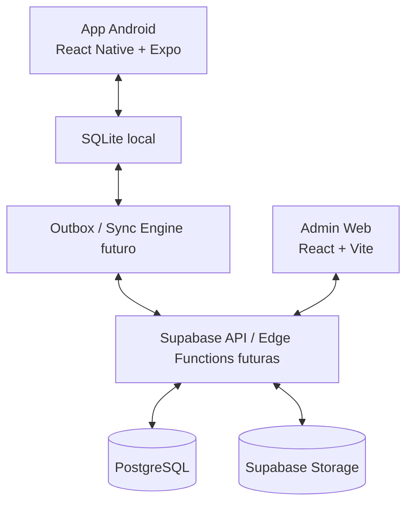

# Arquitectura

## Diagrama general

La flecha entre móvil y SQLite representa operación local inmediata. La comunicación con Supabase es futura y no debe ser requisito para registrar una entrega.

## Capas

1. `packages/domain`: tipos y reglas puras que no conocen React, SQLite ni Supabase.
2. `packages/shared`: contratos mínimos de integración, sin forzar componentes de UI comunes.
3. `apps/mobile`: interfaz del repartidor, persistencia SQLite, captura de firma/GPS, outbox y futuros adaptadores nativos.
4. `apps/admin-web`: interfaz administrativa para navegador.
5. `supabase`: PostgreSQL, Auth, Storage, RLS y futuras Edge Functions.

La interfaz no calcula reglas críticas por su cuenta. Los importes, estados y validaciones de dominio deben reutilizar el paquete de dominio.

## Responsabilidades y límites

- `packages/domain`: matemáticas deterministas, tipos, UUID, folio y contrato de impresión. No conoce React Native, navegador, SQLite ni Supabase.
- `packages/shared`: contratos pequeños de configuración y sincronización. No es un lugar para esconder lógica de infraestructura.
- `apps/mobile`: captura, UX del repartidor, SQLite, permisos GPS y futura coordinación de outbox. No contiene secretos administrativos.
- `apps/admin-web`: navegación y administración para laptop. No lee la base SQLite de un dispositivo.
- `supabase/migrations`: definición central de datos y seguridad SQL. No es ejecutada automáticamente por la app.
- Edge Functions futuras: operaciones servidor que requieran validar autoridad, precios, idempotencia o Storage.

La web y el móvil no se hablan directamente. Ambos usarán contratos y una capa servidor porque el servidor debe validar tenant, identidad, permisos e idempotencia.

PostgreSQL será la fuente central una vez que una operación haya sido confirmada. SQLite es la fuente operacional del dispositivo mientras está offline.

## Multi-tenant

Cada registro de negocio contiene `business_id`. El usuario autenticado pertenece a uno o más negocios mediante `business_users`. Las políticas RLS deben comprobar pertenencia a través de una función `SECURITY DEFINER`; nunca confiar en un `business_id` enviado por la interfaz.

## Identidad de la venta

`sales.id` es UUID y es la identidad técnica. `note_number` es el número visible, legible por ruta. La unicidad de servidor se aplica por negocio y número visible; la idempotencia de reintentos usa el UUID de la venta.

El flujo demo genera un folio provisional para poder probar SQLite. No es un asignador seguro para dos dispositivos offline. Antes de ventas reales se debe implementar reserva de rangos por ruta/dispositivo o asignación equivalente confirmada por servidor.

## Estados

- Venta: `draft`, `signed`, `cancelled`.
- Sincronización local: `local_only`, `pending`, `syncing`, `synced`, `failed`.

Una venta firmada no se edita in-place. Una cancelación futura debe crear un evento auditable y conservar el registro original.

## Interfaces externas

La impresión depende de `PrinterService`, no de Bluetooth ni de una marca. La implementación actual es mock. La sincronización se diseñará como un adaptador que lee outbox y envía contratos idempotentes.

## Trazabilidad a código

- Dominio: `packages/domain/src/types.ts`, `sales.ts`, `folio.ts`.
- Impresión: `packages/domain/src/printer.ts`.
- Captura móvil: `apps/mobile/App.tsx`.
- SQLite y outbox: `apps/mobile/src/storage/database.ts`.
- Contratos públicos preliminares: `packages/shared/src/index.ts`.
- Persistencia central: `supabase/migrations/202501240001_initial_schema.sql`.

## Preguntas abiertas

- ¿Se usará una sola sesión por dispositivo o se permitirá cambio de repartidor durante una ruta?
- ¿Las rutas y folios se asignan en servidor antes de salir o existe una reserva por dispositivo?
- ¿Se requiere una política de retención específica para firmas y GPS?
