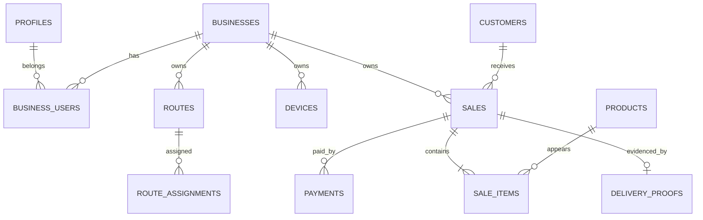

# Modelo semántico de datos

La migración real es `supabase/migrations/202501240001_initial_schema.sql`. Este documento explica el significado de sus entidades; no sustituye el SQL.

## Ownership y claves

- Las entidades de negocio llevan `business_id`.
- Las PK son UUID salvo tablas locales demo y `sale_items` local.
- Dinero central: `bigint` en centavos.
- La venta usa UUID como identidad técnica y `note_number` como folio visible.
- Los FK compuestos `(business_id, id)` reducen el riesgo de relacionar datos de distintos negocios.

## Entidades

| Entidad             | Propósito                                            | Relaciones e invariantes                                                                                      |
| ------------------- | ---------------------------------------------------- | ------------------------------------------------------------------------------------------------------------- |
| `businesses`        | Tenant y configuración básica.                       | Es dueño lógico de catálogos, rutas, dispositivos y ventas.                                                   |
| `profiles`          | Perfil asociado a `auth.users`.                      | La identidad de Auth puede pertenecer a varios businesses mediante `business_users`.                          |
| `business_users`    | Membership y rol.                                    | PK `(business_id, user_id)`; roles iniciales owner, admin, dispatcher y driver.                               |
| `devices`           | Dispositivo Android autorizado.                      | Pertenece a un business; puede tener ruta y repartidor asignados. Código de activación se almacena como hash. |
| `routes`            | Ruta operativa.                                      | Código único por business.                                                                                    |
| `route_assignments` | Asignación de ruta, repartidor, dispositivo y fecha. | No se permite más de una asignación por ruta y fecha dentro del business.                                     |
| `customers`         | Cliente que recibe entregas.                         | Pertenece a un business; nombre único dentro del business en la migración inicial.                            |
| `products`          | Producto vendible.                                   | Precio general en centavos; pertenece a un business.                                                          |
| `customer_prices`   | Precio especial cliente-producto.                    | La combinación cliente-producto identifica el precio; FK compuesto exige mismo business.                      |
| `sales`             | Nota de venta y estado.                              | Requiere ruta, repartidor, dispositivo y cliente del mismo business; `note_number` único por business.        |
| `sale_items`        | Productos y cantidades congelados de una venta.      | Conserva nombre, precio y subtotal usados en la nota.                                                         |
| `payments`          | Forma y monto de pago.                               | Vinculado a una venta; la semántica de crédito y pagos parciales sigue abierta.                               |
| `delivery_proofs`   | Evidencia de entrega.                                | Una por venta y business; contiene receptor, referencia de firma, GPS y timestamps.                           |
| `sync_events`       | Recepción y resultado de operaciones sincronizadas.  | `idempotency_key` único por business.                                                                         |

## Estados centrales

- `sales.status`: `draft`, `signed`, `cancelled`.
- El SQL central no define un enum de sync; el estado local vive en SQLite/outbox.
- Una nota `signed` debe conservar su evidencia y no editarse in-place.

## Diferencia con SQLite actual

La base local definida en `apps/mobile/src/storage/database.ts` es mínima para el demo: usa IDs de texto, guarda un `total_cents` sin `subtotal_cents`, serializa firma y GPS dentro de `sales`, y tiene outbox local. No es una réplica completa del esquema central. La sincronización futura necesitará un mapeo explícito y validación.

## Diagrama ER simplificado

## Preguntas abiertas

- ¿Se deben registrar envases vacíos o depósitos como líneas separadas?
- ¿Una venta puede tener varios pagos?
- ¿Qué campos de dirección y contacto necesita el negocio real?
- ¿Qué política de soft delete se aprobará para clientes y productos?
