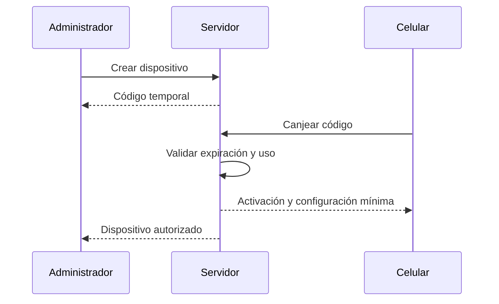

# Activación de dispositivos

## Alcance

La APK será privada durante el MVP. No se requiere publicación en Play Store. El mecanismo de activación es PLANEADO y no está implementado.

## Flujo previsto

1. Administrador autorizado registra un dispositivo en el panel.
2. El servidor crea un código temporal de un solo uso o con expiración corta.
3. El celular introduce el código.
4. El servidor valida el código y registra el dispositivo.
5. El dispositivo queda asociado al business y puede asociarse a repartidor y ruta.
6. El servidor puede revocar el dispositivo perdido o comprometido.

## Reglas de seguridad

- No embebar credenciales administrativas en APK.
- Guardar código como hash del lado servidor.
- Expirar y no reutilizar el código.
- Permitir revocación.
- No asumir que un dispositivo autorizado puede cambiar de business sin nueva autorización.
- Registrar activación y revocación para auditoría.

## Preguntas abiertas

- ¿Se requiere PIN local después de activar?
- ¿Puede un dispositivo cambiar de repartidor durante una jornada?
- ¿El dispositivo se asocia permanentemente a una ruta o solo a una asignación diaria?
