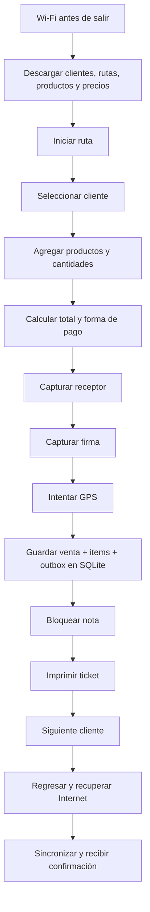
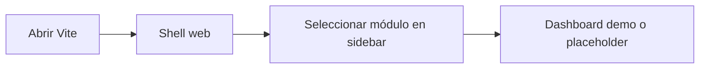
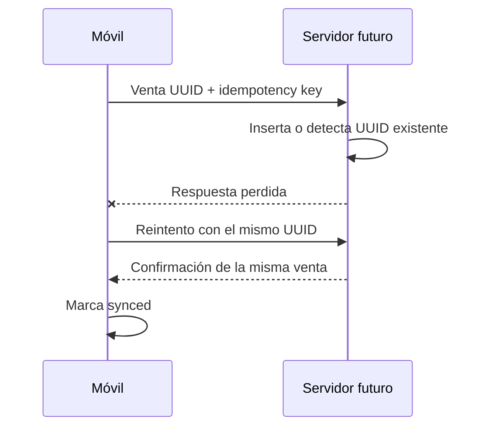

# Flujos de usuario

## Flujo objetivo del repartidor

**Estado actual:** solo la parte local desde selección demo hasta mock de impresión está implementada. Descarga, ruta real y sincronización son PLANEADAS.

## Flujo actual del demo móvil

1. La base SQLite se inicializa con dos clientes y un producto demo.
2. El usuario selecciona cliente.
3. Ajusta cantidad de un garrafón de 20 L.
4. Elige efectivo, transferencia o crédito.
5. Escribe receptor.
6. Dibuja firma con toque.
7. La app intenta permiso y captura de GPS.
8. Guarda venta, item y outbox en transacción.
9. Construye el objeto de impresión.
10. Invoca `MockPrinterService`.
11. Actualiza historial local.

## Flujo administrador actual

No existe login. No consulta SQLite móvil ni Supabase. Las métricas son estáticas y los módulos distintos de Dashboard son placeholders.

## Flujo sin Internet

Durante una ruta sin Internet, la app debe leer catálogos locales y persistir cada venta localmente. En el estado actual esto se simula porque los catálogos son insertados localmente; no existe sincronización inicial ni descarga incremental.

## Error de impresión

La venta ya debe estar confirmada en SQLite antes de imprimir. Si el adaptador real falla por Bluetooth, desconexión o papel, se conserva la venta. El demo captura el error del mock, pero todavía no expone una bandeja de reimpresión en UI.

## Reimpresión

**PLANEADA:** seleccionar una venta local ya guardada y enviar el mismo `sale.id` al `PrinterService`. No insertar otra fila en `sales` ni en `outbox`.

## Sincronización interrumpida

El resultado obligatorio es una sola venta. El worker y endpoint todavía no existen.

## Cancelación futura

**PLANEADA:** un usuario autorizado solicita cancelación, el servidor conserva la nota firmada, registra motivo, actor, timestamp y evento de auditoría. No se permitirá editar silenciosamente la nota original.

## Activación futura de dispositivo

**PLANEADA:** administrador crea dispositivo, servidor entrega código temporal, celular lo canjea y el servidor asocia business, dispositivo, ruta y repartidor. Ver `DEVICE_ACTIVATION.md`.
